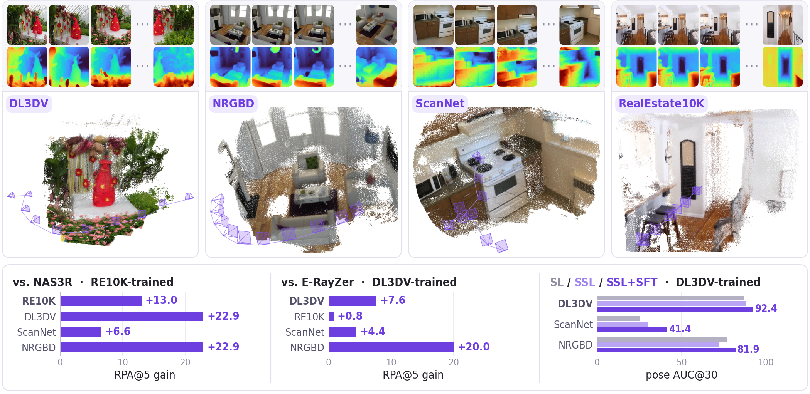

<div align="center">
<h1>Rethinking <span style="color:#7c4deb;">Asymmetry</span> in Self-Supervised 3D Geometry Learning</h1>


<a href="https://gynjn.github.io/rethinking-asymmetry/"></a>

[Gyeongjin Kang](https://gynjn.github.io/info/), [Freeman Cheng](https://freemancheng.com), [Botao Ye](https://botaoye.github.io), [Weijie Lyu](https://www.wlyu.me), [Ming-Hsuan Yang](https://faculty.ucmerced.edu/mhyang/), [Eunbyung Park](https://silverbottlep.github.io)
</div>

Official repo for the paper "**Rethinking Asymmetry in Self-Supervised 3D Geometry Learning**"

<p align="center"></p>

Rather than masking images from the network, we mask them only from the 3D representation, so every image interacts with all others in one unified network to estimate geometry. Trained without any 3D labels, this improves camera pose and depth over prior self-supervised methods.

## Installation

```bash
# 1. Clone the repository
git clone https://github.com/Gynjn/rethinking-asymmetry.git
cd rethinking-asymmetry

# 2. Create and activate conda environment
conda create -n ssl3d python=3.10 -y
conda activate ssl3d

# 3. Install dependencies (adjust the CUDA version to match your system)
pip install torch==2.4.1 torchvision==0.19.1 --index-url https://download.pytorch.org/whl/cu118
pip install -r requirements.txt

# 4. Install gsplat with gradients w.r.t. camera intrinsics
pip install git+https://github.com/QitaoZhao/gsplat.git --no-build-isolation
```

## Checkpoints

The DL3DV-trained model is hosted on [HuggingFace](https://huggingface.co/Gynjn/rethinking-asymmetry) ([model_dl3dv.pt](https://huggingface.co/Gynjn/rethinking-asymmetry/resolve/main/model_dl3dv.pt?download=true)). All scripts download it to `checkpoints/model_dl3dv.pt` on first use; pass `--ckpt <path>` to use another checkpoint, e.g. one written by `train.py`.

Training additionally uses the following weights (not needed for inference):

| File | Used for |
|---|---|
| `checkpoints/pixio_vitb16.pth` | [Pixio](https://github.com/facebookresearch/pixio) ViT-B/16: encoder initialization and the frozen semantic-alignment target |
| `checkpoints/imagenet-vgg-verydeep-19.mat` | Perceptual loss (downloaded automatically on first use) |

## Data

DL3DV in the `opencv_cameras.json` layout, one directory per scene:

```
<data_root>/<scene_id>/opencv_cameras.json    # {"scene_name", "frames": [{"file_path", "fx", "fy", "cx", "cy", "w2c"}, ...]}
<data_root>/<scene_id>/images_undistort/...   # frames, paths relative to the scene directory
```

`data/dl3dv10k_train.txt` (9,995 scenes) and `data/dl3dv10k_benchmark.txt` (140 scenes) list the scene ids. Set `data_root` for each in `configs/dl3dv.yaml`.

ScanNet v2 and NRGBD follow ZipMap's preprocessing (layout in `data/indoor_eval.py`).

## Inference

```bash
CUDA_VISIBLE_DEVICES=0 python inference.py --images path/to/frames --num_views 10 --out out/
```

The script takes `--num_views` frames spaced evenly over the sorted folder and, from one forward pass, writes:
- `cameras.json`: camera-to-world poses relative to the middle frame, plus pixel intrinsics.
- `depth_XX.npy`: planar z-depth, with `depth_XX.png` previews.
- `points.ply`: the pixels lifted with the predicted cameras.

Scale is arbitrary, as in any self-supervised model.

```python
from utils.model_io import load_images, load_model
model, config = load_model("configs/dl3dv.yaml")   # downloads model_dl3dv.pt on first use
out = model.predict(load_images(paths)[None].cuda())   # c2w [1, v, 4, 4], fxfycxcy [1, v, 4], depth [1, v, 1, h, w]
```

`depth` is the distance along each unit ray; `model.mvssl.ray_to_z` converts it to planar depth.

## Evaluation

**Camera pose on DL3DV.** The protocol follows E-RayZer: 10 frames at `linspace(0, 96, 10)` per benchmark scene, all passed as input, scored with pairwise relative pose accuracy (RPA) and AUC in temporal order (`utils/pose_metrics.py`). The forward pass runs under bf16 autocast as in E-RayZer's `evaluate.py` (`--precision fp32` for full precision).

```bash
CUDA_VISIBLE_DEVICES=0 python evaluate_pose.py --data_root /path/to/dl3dv_benchmark
# RPA@3 70.0  RPA@5 79.7  RPA@10 86.5  RPA@15 89.8  RPA@30 94.3  AUC@30 84.0
```

**Pose and depth on ScanNet v2 / NRGBD.** One forward pass on 10 frames per scene. Multi-view depth is decoded for `--depth_views input` (the 5 context views [0, 2, 4, 6, 9], as in the comparison with E-RayZer) or `all`, and single-view depth runs each of those views alone (`--no_single_view` skips it). Depth is converted to planar z with the predicted intrinsics and scored per view with median scaling.

```bash
CUDA_VISIBLE_DEVICES=0 python evaluate_indoor.py --dataset scannet --data_root /path/to/scannetv2 --depth_views input
CUDA_VISIBLE_DEVICES=0 python evaluate_indoor.py --dataset nrgbd   --data_root /path/to/nrgbd     --depth_views input
# scannet  pose RPA@3 6.6  RPA@5 16.7  AUC@30 49.9 | multi-view AbsRel 0.125 δ<1.25 0.872 | single-view AbsRel 0.099 δ<1.25 0.912
# nrgbd    pose RPA@3 63.5 RPA@5 81.5  AUC@30 87.2 | multi-view AbsRel 0.082 δ<1.25 0.917 | single-view AbsRel 0.113 δ<1.25 0.859
```

**Evaluation scenes.** The scenes and frames behind the paper's 10-view numbers:

| File | Content |
|---|---|
| `data/dl3dv10k_benchmark.txt` | 140 DL3DV scenes; frames `linspace(0, 96, 10)` |
| `data/re10k_10view_eval_index.json` | 5,601 RE10K test scenes, each mapped to its 10 frame indices (SPFSplat's 10-view sampler, in temporal order) |
| `data/scannetv2_eval_scenes.txt` | 97 ScanNet v2 scenes; frames `linspace(0, 64, 10)` of the stride-3 sequence |
| `data/nrgbd_eval_scenes.txt` | 9 NRGBD scenes; frames `linspace(0, 256, 10)` |
| `data/figure_scenes.json` | Scenes shown in the camera-trajectory figures |

## Figures

**Camera trajectories and APE.** Each prediction is aligned to the ground-truth cameras with one Sim(3) (Umeyama on camera centres); APE is the RMSE of the aligned camera centres. Pose dumps come from `--out` of the evaluation scripts, and other methods can be added as `--pred NAME=dump.json` in the same format.

```bash
python evaluate_pose.py --data_root /path/to/dl3dv_benchmark --out ours_dl3dv.json
python tools/trajectory_figure.py --group dl3dv_main --pred Ours=ours_dl3dv.json --out figs/
```

**3D reconstruction.** The model's own output, nothing fitted: every pixel is placed along its predicted ray at its predicted depth with the predicted camera, filtered for multi-view consistency, and rendered with the predicted cameras (`--orbit N` adds an orbit video).

```bash
python tools/render_reconstruction.py --images "/path/to/dl3dv/<scene>/images_undistort/*.png" \
    --frame_ids 0,10,21,32,42,53,64,74,85,96 --out recon.png
```

## Train

Update `data_root` in `configs/dl3dv.yaml`, and set `training.wandb_project` (with your wandb API key in `configs/api_keys.yaml` or `WANDB_API_KEY`) to log to wandb.

```bash
# Example for multi GPU training
torchrun --nproc_per_node 8 --nnodes 1 \
         --rdzv_id 1234 --rdzv_endpoint localhost:8888 \
         train.py --config configs/dl3dv.yaml
# any config value can be overridden, e.g. training.checkpoint_dir=... training.lr=...
```

Each batch uses a single view count from {5, 7, 9, 11}, split into (N+1)/2 context and (N−1)/2 held-out views.

## Citation
```
@article{kang2026rethinking,
  title={Rethinking Asymmetry in Self-Supervised 3D Geometry Learning},
  author={Kang, Gyeongjin and Cheng, Freeman and Ye, Botao and Lyu, Weijie and Yang, Ming-Hsuan and Park, Eunbyung},
  journal={arXiv preprint},
  year={2026}
}
```

## Related project

This project is built on many amazing research works, thanks a lot to all the authors for sharing!

- [E-RayZer](https://github.com/QitaoZhao/E-RayZer) and [RayZer](https://github.com/hwjiang1510/RayZer)
- [VGGT-Omega](https://github.com/facebookresearch/vggt-omega) (DPT head, `model/dense_head.py`)
- [gsplat](https://github.com/nerfstudio-project/gsplat)
- [Pixio](https://github.com/facebookresearch/pixio) (encoder and transformer layers, `model/pixio.py`, `model/layers/`)

## License

See `LICENSE.md`. Code derived from Meta's research releases is distributed under the FAIR Noncommercial Research License: `model/dense_head.py` from VGGT-Omega (`licenses/LICENSE_VGGT-Omega`), and `model/pixio.py` and `model/layers/` from Pixio (`licenses/LICENSE_Pixio`).
